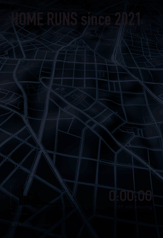

# strava-home-runs

Turns GPX, TCX or FIT files (from Strava, Garmin or any other GPS source) into a 3D video of every run that started within a chosen radius of one point. It generalizes the script I used to animate five years of runs that started from my home.

<p align="center"></p>

All runs leave the origin at the same moment and each one moves at its real pace, so the fast runs pull ahead and the long runs keep going after. Routes that you run often glow brighter, because overlapping runs add up like a heat map. A clock, a "still running" counter and a histogram of finish times fill in as runners get home. The runner marker can be a cut-out of your face or any image of your choice.

The map is built from free data: OpenStreetMap streets and AWS Terrain Tiles elevation. It runs in Blender, with no API keys.

## Requirements

- [pixi](https://pixi.sh). It installs Python, the Python packages and ffmpeg into a local environment.
- [Blender](https://www.blender.org/download/) 5.0 or newer (tested with 5.2), installed separately.

<details>
<summary>macOS (Homebrew)</summary>

```bash
brew install pixi
brew install --cask blender
```

</details>

<details>
<summary>Linux</summary>

```bash
curl -fsSL https://pixi.sh/install.sh | sh
sudo snap install blender --classic   # or the tarball from blender.org
```

</details>

<details>
<summary>Windows (PowerShell)</summary>

```powershell
winget install prefix-dev.pixi
winget install BlenderFoundation.Blender
```

</details>

Check that Blender is 5.0 or newer with `blender --version`.

The tool looks for Blender on your `PATH` and in `/Applications/Blender.app`. Use `--blender /path/to/blender` to point it somewhere else.

[uv](https://docs.astral.sh/uv/) also works (`uv run homeruns ...`), but then ffmpeg has to be on your `PATH`.

## Getting your files

- **Strava:** Settings → My Account → Download or Delete Your Account → Request your archive. The `activities/` folder in the zip has `.gpx` files, and `.fit.gz` files for activities uploaded from a watch.
- **Garmin Connect:** request the bulk export under Account → Data Management → Export Your Data. The activity FIT files are inside further zip files in the export; unzip those too. You can also export a single activity from its ⚙ menu.

The tool reads `.gpx`, `.tcx` and `.fit` files, also gzipped, and searches folders recursively. Point it at the whole export folder.

## Usage

Run it from this folder. The first `pixi run` sets up the environment.

```bash
pixi run homeruns ~/Downloads/strava_export/activities --face me.png --place Lisbon --preview
```

`pixi run homeruns --help` lists all options.

`--preview` renders at half size and every second frame, which takes a few minutes. Check the result, then run the same command without `--preview` for the full 1440×2560 video.

Rendering takes about 5 s per frame on an Apple Silicon Mac, so the default video (30 s of running plus the intro and outro, about 1,100 frames) takes around 1.5 hours.

The tool:

1. Reads every track and keeps the runs (`--sport`, default `run`; files without a type are kept).
2. Finds home: the place where most runs start (or `--home lat,lon`). Keeps the runs that start within `--radius` metres (default 200).
3. Cleans the GPS:
   - Drops spikes faster than `--max-speed` (7 m/s).
   - Cuts a track where the signal is lost for good, for example in the metro.
   - Shortens long pauses.
4. Downloads elevation and streets for the area. These are cached in `--work` (default `.homeruns/`).
5. Builds and renders the scene in Blender, adds the overlay and encodes `home_runs.mp4` plus `home_runs_final.png`.

### Changing the text without rendering again

The title, subtitle, clock, histogram and credit are drawn on the frames after Blender has rendered them. Add `--keep-frames` to the render, and you can redo that step later in a few minutes:

```bash
pixi run homeruns ~/Downloads/strava_export/activities --face me.png --place Lisbon --keep-frames
pixi run homeruns --overlay-only --title "MY HOME RUNS" --place Lisbon
```

`--overlay-only` takes no track files and doesn't need Blender. It reads the frames, timing and run list from the work folder, so pass the same `--work` (and `--preview` for preview frames). It accepts the text, font, `--out` and `--crf` options. Anything in the 3D scene, such as the map, routes, camera, marker or `--seconds`, needs a full render. The kept frames take a few GB at full size.

### Run count and distance in the text

The title and subtitle can include numbers from the runs in the video: `{runs}`, `{km}` (total distance), `{first_year}` and `{last_year}`. Add a format after a colon, as in Python:

```bash
pixi run homeruns ~/Downloads/strava_export/activities --title "All my runs from home since {first_year}" \
    --subtitle "{runs} runs, {km:.0f} km, Lisbon"
```

The distance is measured on the cleaned tracks after `--privacy-radius`, so it can be a little lower than Strava's total. Frames kept before `{km}` was added don't store distances, so `--overlay-only` can't fill it for them.

### Face marker

Pass a PNG or WebP of a face on a **transparent background** with `--face`. On macOS and iOS, "Copy Subject" or "Lift subject from background" in Photos makes one. The face is tinted orange by default; use `--tint 0` to keep its colours. Without `--face`, each runner is an orange dot.

### Options

| Option | Default | |
|---|---|---|
| `--title`, `--subtitle` | `HOME RUNS since <year>`, `<n> runs, <total> km` | Text at the top; can use `{runs}`, `{km}`, `{first_year}`, `{last_year}` |
| `--place` | | Added to the default subtitle |
| `--radius` | 200 | Metres from home a run must start within |
| `--home` | auto | `lat,lon` of home |
| `--since`, `--until` | | Date range, `YYYY-MM-DD` |
| `--sport` | `run` | Keep tracks whose type contains this; `any` keeps all |
| `--seconds` | 30 | Video seconds until the longest run finishes |
| `--size` | `1440x2560` | Output size; the layout is made for 9:16 |
| `--privacy-radius` | 0 | Cut this many metres around home from every track |
| `--no-sea` | | Don't treat land at sea level as sea (needed in places like the Netherlands) |
| `--line-strength` | auto | Brightness of a single route |
| `--crf` | 16 | Video quality; higher gives a smaller file |
| `--font-title`, `--font-text`, `--font-clock` | system fonts | TTF/OTF files |
| `--keep-frames` | | Keep the rendered PNGs in the work folder |
| `--overlay-only` | | Redraw the text on kept frames and encode, without Blender |

## Privacy

The video opens on your location of choice and every run leaves from it, which might show where you live.

`--privacy-radius 300` cuts the first and last 300 m of every track. It also drops the shared start point, so each runner appears at the edge of the circle. Strava's privacy zones work the same way. With many runs though, the centre of the circle can still be estimated, so leave out the video if your address must stay private.

## How it works

- **Timing:** the clock starts slowly and speeds up exponentially, so the busy first minutes are readable and the long runs don't drag.
- **Camera:** at every frame, it finds the closest position at which everything drawn so far fits between the title and the clock.
- **Heat:** routes render additively in a separate view layer, and the compositor maps the sum onto a heat colour ramp.
- **Marker:** each face is a camera-facing card at the head of its route.

The code is in `homeruns/`:

| File | Role |
|---|---|
| `tracks.py` | Reads GPX/TCX/FIT, finds home, cleans GPS |
| `basemap.py` | Downloads elevation and streets |
| `prepare.py` | Builds the street texture and route points |
| `scene.py` | Builds the scene in Blender |
| `render_setup.py` | Render settings |
| `overlay.py` | Text, histogram and encoding |
| `timewarp.py` | Clock curve |
| `face.py` | Face and dot marker sprites |
| `__main__.py` | Command line and pipeline |

## Credits

- Map data © [OpenStreetMap](https://www.openstreetmap.org/copyright) contributors (ODbL). The video carries this credit.
- Elevation from [AWS Terrain Tiles](https://registry.opendata.aws/terrain-tiles/) (SRTM, GMTED, NED and other sources).
- Strava is a trademark of Strava, Inc. and Garmin is a trademark of Garmin Ltd. This project is not affiliated with or endorsed by either.

## License

MIT
